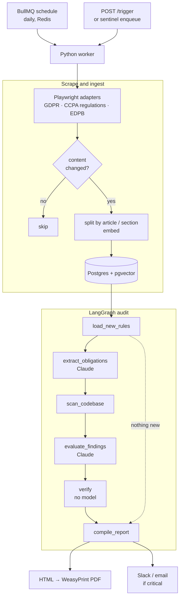

# Compliance Sentinel Agent

[](https://github.com/ravibandakkanavar/compliance-sentinel-agent/actions/workflows/ci.yml)

A LangGraph agent that watches privacy regulators for new and amended rules,
audits a codebase against whatever changed, and writes an audit-ready PDF
report in which every finding cites the code and the regulation text it is
based on.

Once a day it:

1. **Scrapes** the GDPR, the CCPA regulations and the EDPB news feed.
2. **Detects changes** by hashing each document and each section, so unchanged
   text costs nothing.
3. **Extracts obligations** from new or amended sections: duties that can be
   checked by reading source code.
4. **Audits the target repository** against those obligations.
5. **Verifies every finding** without the model: the quoted code must exist in
   the named file and the quoted rule must exist in the stored regulation text.
   Anything that fails is discarded and counted.
6. **Writes the report** (HTML and PDF) and **alerts** Slack or email when a
   finding is critical.

## Status

This is a portfolio project. What has and has not been exercised:

| Part | State |
| --- | --- |
| Scrapers | Run against the live sites: 15 GDPR sections, 43 CCPA regulation sections and 10 EDPB notices on a first run, nothing on an immediate second run |
| Change detection, chunking, verification, report, scoring, alerts, trigger API | Covered by the test suite |
| Full pipeline | Tested end to end with a stubbed model |
| Postgres store, Docker image (WeasyPrint, Chromium, embedding model) | Exercised by CI |
| Calls to Claude | Written against the Anthropic SDK but **not yet run with a real API key**, so there are no measured recall or precision figures yet |
| Fly.io deployment | Configuration only; not deployed |

The original brief claims this "saves legal teams 40+ hours/week". Nothing here
measures that. Treat it as a hypothesis until a manual audit has been timed
against the agent on the same codebase.

## Architecture



### Why the findings can be trusted further than a plain LLM answer

The model proposes; plain code decides what is kept. For each proposed finding
the `verify` node checks that:

- the file exists in the audited repository;
- the code the model quoted is in that file (line numbers are then taken from
  where the code really is, not from what the model said);
- the rule text the model quoted is in the stored copy of the section it cites;
- the model's own confidence is at least 50%.

The same quote check is applied when obligations are extracted, so an invented
duty never reaches the audit. The counts of discarded items are printed in the
report's appendix.

This removes fabricated citations and fabricated code. It does not make the
model's judgement correct: a finding can quote real code and a real rule and
still be a misreading. The report says so, and findings should be confirmed by
a qualified reviewer.

## Quick start

Requirements: Docker, and an Anthropic API key.

```bash
cp .env.example .env          # then set ANTHROPIC_API_KEY
docker compose up -d postgres redis
docker compose run --rm migrate
```

Run an audit of the bundled demo app against a small synthetic regulation (no
scraping, a handful of model calls):

```bash
docker compose run --rm worker sentinel run --demo
```

Then simulate a regulator amending that regulation. Only the reworded section
and the two new sections are audited:

```bash
docker compose run --rm worker sentinel run --simulate-amendment
```

Reports are written to `data/reports/` as `audit-run-N.html`, `.pdf` and `.json`.

Run against the real regulators and your own code:

```bash
docker compose run --rm worker sentinel run --repo https://github.com/you/your-repo
```

A first real run sends about 60 regulation sections to the model for
obligation extraction, then makes one audit call per obligation. Later runs
only pay for sections whose text changed.

### Commands

| Command | What it does |
| --- | --- |
| `sentinel migrate` | Apply database migrations |
| `sentinel scrape [--source NAME]` | Scrape and store what changed, without auditing |
| `sentinel search "query"` | Hybrid search over the stored regulation text, with citations |
| `sentinel run [--repo PATH_OR_URL] [--full]` | Scrape, audit new rules, write the report. `--full` re-audits every stored obligation |
| `sentinel run --demo` / `--simulate-amendment` | Use the bundled synthetic regulation |
| `sentinel score data/reports/audit-run-N.json` | Score findings against the seeded violations |
| `sentinel worker --cron "0 6 * * *"` | Process queued audits and register the daily schedule |
| `sentinel enqueue` | Queue an audit for the worker |

### Manual trigger

```bash
curl -X POST http://localhost:8080/trigger \
  -H "Authorization: Bearer $SENTINEL_TRIGGER_TOKEN" \
  -H "Content-Type: application/json" -d '{"full": true}'
```

The endpoint returns 503 until `SENTINEL_TRIGGER_TOKEN` is set.

## Evaluation

`demo_repo/` is a small Flask shop backend with 12 seeded privacy and security
violations: plaintext passwords, personal data in logs, a pre-ticked consent
box, deletion that only sets a flag, a data feed that ignores the do-not-sell
flag, and others. The answer key is `evals/ground_truth.json`.

```bash
docker compose run --rm worker sentinel run
docker compose run --rm worker sentinel score /data/reports/audit-run-1.json
```

The scorer reports recall on the seeded violations, the share of findings that
match one, and lists unmatched findings for manual review (an unmatched finding
may be a real problem that was not seeded). The plan's targets are at least 70%
recall and 100% citation accuracy; citation accuracy is enforced by
construction, since a finding with a quote that does not check out is never
reported. **These numbers have not been measured yet.**

## Configuration

Everything is set through environment variables; see `.env.example`.

Regulatory sources live in `sentinel/sources.yaml`. Each source lists the
sections to ingest, which defaults to those that govern how software handles
personal data. Remove a source's `include` list to ingest the whole instrument.

To add a regulator, write an adapter with two methods, `fetch()` and `parse()`
(see `sentinel/scrapers/base.py`), and register it in
`sentinel/scrapers/__init__.py`.

## Project layout

```
sentinel/
  scrapers/     one adapter per source: eurlex, cppa, edpb, local
  ingest/       change detection, chunking, embeddings
  store/        Postgres + pgvector store, and an in-memory twin for tests
  agent/        LangGraph graph, nodes, prompts, repository reading
  report/       Jinja2 template and WeasyPrint rendering
  migrations/   SQL schema
  fixtures/     the synthetic demo regulation, original and amended
  llm.py        structured calls to Claude
  pipeline.py   one end-to-end run
  queueing.py   BullMQ schedule and worker
  api.py        /health and /trigger
demo_repo/      deliberately non-compliant audit target
evals/          ground truth for the seeded violations
tests/
```

## Design notes

- **No Node.js service.** The plan allowed for a small Node scheduler in case
  the Python BullMQ package could not run repeating jobs. It can, so the
  schedule and the worker are both Python.
- **GDPR comes from the EU Publications Office, not the EUR-Lex website.**
  EUR-Lex answers automated browsers with a challenge page. The Publications
  Office endpoint is the EU's service for machine access to the same text.
- **Small repositories are read whole.** When the audited code fits a size
  budget, every obligation sees all of it. The text is identical across calls,
  so it is served from the prompt cache, and a missing safeguard is visible
  where a keyword search would find nothing. Larger repositories fall back to
  search-selected snippets.
- **Local embeddings.** Embeddings come from a small ONNX model
  (`bge-small-en-v1.5`) baked into the image, so retrieval needs no second API key.
- **Refusal fallback is on.** Audit prompts discuss security weaknesses, which
  a safety classifier may decline. Calls opt in to Anthropic's server-side
  fallback; set `SENTINEL_ENABLE_FALLBACKS=false` to turn it off.
- **The health probe touches nothing.** A probe that queried Postgres or Redis
  on an interval would keep scale-to-zero databases awake all day.

## Deploying to Fly.io

`fly.toml` defines two processes: the worker (always on, so it can fire the
schedule) and the API (stops when idle). You need a Postgres database with the
`vector` extension and a Redis instance, for example Fly Postgres or Neon, and
Upstash Redis. The setup commands are at the top of `fly.toml`.

Cost note: the worker holds a blocking connection to Redis around the clock,
which is how BullMQ waits for work. On a usage-billed Redis this is steady
low-volume traffic, so check your provider's pricing for idle connections.

## Development

```bash
python -m venv .venv && . .venv/bin/activate   # Windows: .venv\Scripts\activate
pip install -e ".[dev]"
playwright install chromium
pytest
```

The tests need no API key, database or network. To include the Postgres tests,
set `TEST_DATABASE_URL` to a pgvector database. PDF output needs WeasyPrint's
native libraries, which are awkward on Windows; without them the HTML report is
still written. Use the Docker image for PDFs.

## Limitations

- The demo answer key is small and written by the same person as the code, so
  good scores on it say little about performance on real repositories.
- Section-level change detection treats a reworded section as new. If a long
  section is re-split after an insertion, its later parts are re-audited too.
- Obligations that code cannot evidence (appointing a DPO, notifying a
  regulator) are deliberately left out. A clean report is not a compliance
  certificate.
- Scrapers depend on page structure and will need maintenance when a regulator
  redesigns its site. A failed or empty scrape is reported and alerted, not
  silently treated as "no changes".
